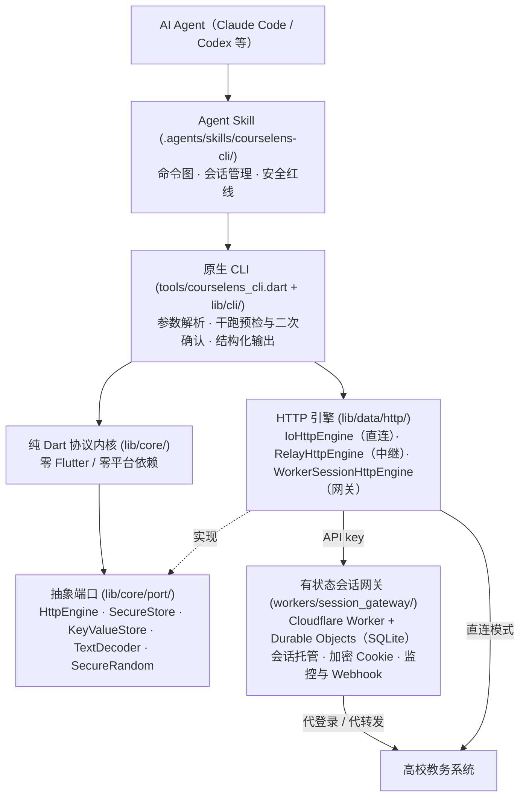

# 系统架构与协议设计

> 本文档描述开源版（CLI + Agent Skill + 会话网关）的架构。协议内核与 CourseLens App 共用同一套纯 Dart 代码，本仓库只抽取与 CLI / 网关相关的部分。

CourseLens 采用**端口与适配器（Hexagonal / Clean Architecture）**分层：教务协议、解析与安全策略全部沉淀在零平台依赖的纯 Dart 内核中，CLI 与网关只负责提供 HTTP 传输、凭据存储与运行外壳。

## 分层总览

## 1. 纯 Dart 协议内核（`lib/core/`）

`lib/core/` 不依赖 Flutter 与任何平台 API，同一套代码服务于 App、CLI 与演示夹具。

| 模块 | 职责与核心类 | 代码位置 |
| --- | --- | --- |
| 业务总门面 | `AcademicClient`：统一暴露登录、课表、成绩、考试、学业进度、空教室、已选名单、选/退课与 `.ics` 导出接口 | [`lib/core/academic_client.dart`](../lib/core/academic_client.dart) |
| 抽象端口 | `HttpEngine`、`SecureStore`、`KeyValueStore`、`TextDecoder`、`SecureRandom` | [`lib/core/port/`](../lib/core/port/) |
| 加密与编码 | 零外部加密库依赖的 `BigInt` RSA PKCS#1 v1.5（`ZhengfangRsa`）与严格 `Base64Codec` | [`lib/core/crypto/`](../lib/core/crypto/) |
| 登录协议流 | 新正方直连 `ZhengfangJwglxtLoginFlow`、CAS 认证 `ZhengfangCasLoginFlow`、浏览器会话接管 `BrowserSessionImportFlow` | [`lib/core/login/`](../lib/core/login/) |
| 教务读取与探测 | `StudyProbe`、`StudyReader`、`StudyTransport`：覆盖课表（含 `sjkList` 实践课）、成绩（含分项明细）、考试、校区作息、学业进度（`N105515`）、已选名单（`N255010`）、空教室（`N2155`） | [`lib/core/study/`](../lib/core/study/) |
| 解析与数学 | `SystemDetector`、HTML/JSON 解析器、GBK/UTF-8 嗅探（`PageCharset`）、`GradeMath`（加权均分、必修绩点、初修/补考/重修去重、补考绩点 1.00 封顶） | [`lib/core/parse/`](../lib/core/parse/) |
| 自主选课 | `ZhengfangSelection`：轮次/分类读取、课程查询、教学班余量查询与确认门禁后的选/退课请求 | [`lib/core/selection/zhengfang_selection.dart`](../lib/core/selection/zhengfang_selection.dart) |
| 课表与日历规划 | `WeekGridPlanner`（区间图贪心泳道）、`ScheduleConflicts`、`PeriodScheduleBuilder`、`IcsExport`（RFC 5545）、`CourseReminderPlanner` | [`lib/core/schedule/`](../lib/core/schedule/) |
| 会话与凭据隔离 | `SessionStore`、`AccountSession`（`epoch` + 可重入 `Zone` 协议锁 + `retire()`）、`CredentialVault`、`SessionArchive` | [`lib/core/session/`](../lib/core/session/) |
| 网络安全与 Cookie | `HostPolicy`、RFC 6265 `CookieJar` & `SetCookie`、`GuardedHttpEngine`、`HostGuardedHttpEngine`、`FixtureHttpEngine` | [`lib/core/net/`](../lib/core/net/) |

## 2. CLI 层（`lib/cli/` + `tools/`）

- `tools/courselens_cli.dart` 是唯一入口，编译为单个原生可执行文件，外部依赖仅 `charset`、`html`、`http` 三个包。
- `lib/cli/` 负责参数解析（`cli_args`）、命令执行（`cli_runner`）、文本/JSON 双格式输出（`cli_formatters`）与本地会话存储（`store/`：macOS Keychain 或 `~/.config/courselens/session.json`，文件权限强制 `0600`）。
- 写操作（选课/退课）一律先干跑预检、输出将要提交的内容，带 `--confirm` 才真正发请求；结果未知（`RESULT_UNKNOWN`）时只允许只读核查，绝不盲目重发。
- 内置 `--demo` 演示夹具（`cli_demo_fixtures`），无账号即可体验全部只读命令的输出形态。

## 3. HTTP 引擎（`lib/data/http/`）

| 引擎 | 用途 |
| --- | --- |
| `IoHttpEngine` | 直连模式：禁用自动跳转，单跳手动追踪 302 与多值 `Set-Cookie` |
| `RelayHttpEngine` | 经无状态中继转发（浏览器同源限制场景的兜底） |
| `WorkerSessionHttpEngine` | 网关模式：请求发往自托管会话网关，本地不持有 Cookie 与密码，只带 API key |

## 4. 有状态会话网关（`workers/session_gateway/`）

Cloudflare Worker + SQLite Durable Object，一人一份、自托管：

- 登录会话（Cookie）只存在 Durable Object 内，落盘前经 AES-256-GCM 加密；客户端只用 API key 访问（摘要 + 常量时间比对，支持多 key）。
- 会话失效自动单次重登并重放安全请求；懒保活模式下无流量时零唤醒、零上游请求。
- 内置云端任务中心：成绩变化监控、考试安排监控、会话保活（全部默认关闭），变更经 Webhook（Bark / 飞书 / 钉钉 / 企微 / Telegram / 通用 JSON）推送。
- 上游访问带主机白名单与 SSRF 防护、请求/响应体积上限与安全响应头。

详细设计见 [stateful-worker-api-key.md](stateful-worker-api-key.md)，安全模型见 [security.md](security.md)。

> 本仓库有意不包含无人值守抢课功能：选课/退课只以「本人确认后单次提交」的形式提供。
