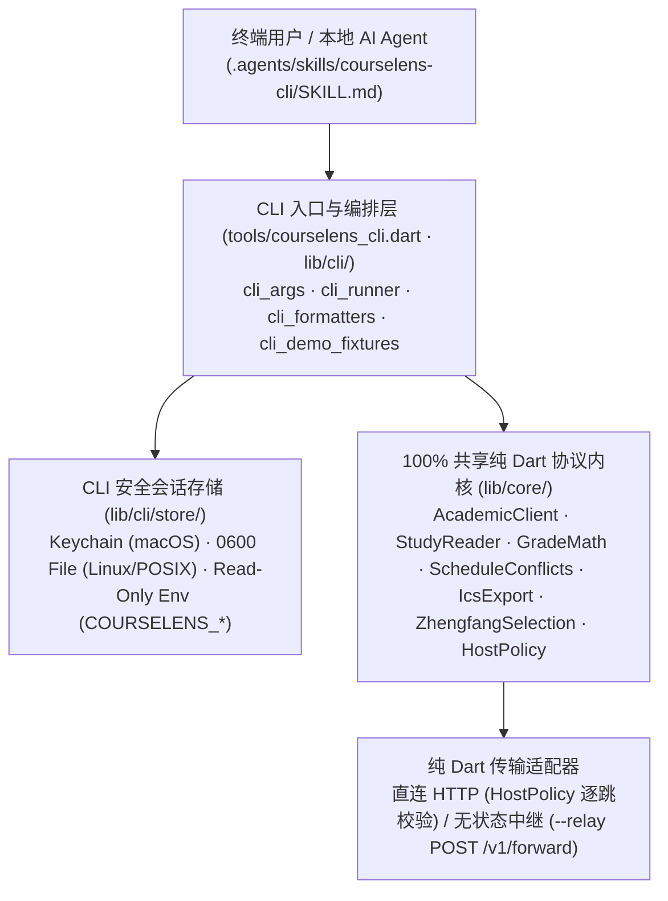

# 原生命令行（CLI）与 AI Agent Skill 指南

除了五端图形界面（Web · Android · Windows · macOS · iOS），CourseLens 还内置了**零 Flutter 依赖的原生命令行工具（`courselens`）**与开箱即用的 **AI Agent Skill（[`SKILL.md`](../.agents/skills/courselens-cli/SKILL.md)）**。无论是开发者在终端快速查课表、算绩点、导出 `.ics` 日历，还是让本地 AI 助手（Antigravity、Gemini CLI、Claude Code、Codex 等）以最小 Token 开销安全调用教务能力，均复用同一套经过严格验证的协议内核与 **7 条安全硬红线**。

---

## 1. 架构设计：100% 共享 `lib/core/` 纯 Dart 内核

`tools/courselens_cli.dart` 与 `lib/cli/` 完全遵循项目的端口与适配器边界：**零 `package:flutter/` 导入**，仅依赖纯 Dart 标准库与 `dart:io`，可直接通过 `dart compile exe` 编译为无运行时依赖的原生机器码可执行文件。



核心设计亮点：
- **协议与算法零分叉**：登录加密（`ZhengfangRsa` + CSRF / CAS）、四套教务系统自动识别（`ZF` / `ZF_OLD` / `QZ` / `QZ_OLD`）、成绩加权均分与补考 `1.00` 绩点封顶（`GradeMath`）、时间冲突检测（`ScheduleConflicts`）、RFC 5545 `.ics` 日历生成（`IcsExport`）及选退课门禁（`ZhengfangSelection`）均 100% 调用 [`lib/core/`](../lib/core/)。
- **任意工作目录独立运行（`--demo` 内嵌夹具）**：脱敏演示夹具直接编译进 [`lib/cli/cli_demo_fixtures.dart`](../lib/cli/cli_demo_fixtures.dart)，编译后的 `build/courselens --demo ...` 在任意目录均可离线运行，无需依赖仓库 `assets/fixtures/demo.fixtures.json`。
- **标准流职责分离**：人类易读的紧凑 Markdown/表格（默认）或结构化 JSON（`--json`）严格输出至 `stdout`，诊断提示与错误详情输出至 `stderr`，便于管道组合（如 `--json | jq`）。

---

## 2. 编译与快速开始

```bash
# 克隆仓库并进入根目录（若已在仓库内可跳过克隆）
git clone https://github.com/VanceHud/CourseLensFlutter.git
cd CourseLensFlutter

# 拉取依赖并编译原生独立可执行文件
flutter pub get
dart compile exe tools/courselens_cli.dart -o build/courselens

# （推荐）软链接至 ~/.local/bin，便于全局终端与 AI Agent 直接调用 courselens
mkdir -p ~/.local/bin
ln -sf "$(pwd)/build/courselens" ~/.local/bin/courselens

# 无需配置账号，立即在任意目录体验离线演示模式
~/.local/bin/courselens --demo today
~/.local/bin/courselens --demo grades --stats
~/.local/bin/courselens --demo schedule --week 1 --ics /tmp/demo.ics
~/.local/bin/courselens --demo courses
~/.local/bin/courselens --demo select --course-id <id>      # 干跑预检（零写发包，退出码 2）
```

开发调试阶段也可以直接通过 `dart run` 执行：

```bash
dart run tools/courselens_cli.dart --demo today
```

---

## 3. 会话与凭据存储后端（`lib/cli/store/`）

CLI 通过 `--store <auto|keychain|file|env>` 与 `--session-file <path>` 管理教务会话记录（`CliSessionRecord`：包含 `baseUrl`、`username`、`systemType`、`cookies`、`relayUrl`、`updatedAt`），严格执行**红线 #1（安全存储不可用时快速失败，绝不静默降级明文）**。

| 存储后端 | 触发条件（`--store auto` 默认优先级） | 持久化位置与安全机制 | 读写属性 |
| --- | --- | --- | --- |
| **`env`** | 显式 `--store env`，或未指定 `--session-file` 且环境变量中 `COURSELENS_BASE_URL` 与（`COURSELENS_COOKIES` 或 `COURSELENS_USERNAME`）非空 | 仅从进程环境变量读取，零磁盘落盘 | **只读**（执行 `save`/`clear` 抛出 `STORAGE_UNAVAILABLE`） |
| **`keychain`** | macOS 下 `--store auto` 默认值（未指定 `--session-file` 且未命中 `env`） | 调用 `/usr/bin/security` 读写 macOS 钥匙串（`service: dev.courselens.cli`，`account: default`）；若钥匙串拒绝访问或出错，立即抛出 `STORAGE_UNAVAILABLE`，**绝不回退写入明文文件** | 读写 |
| **`file`** | Linux 下 `--store auto` 默认值，或显式传入 `--store file` / `--session-file <path>` | 默认路径 `~/.config/courselens/session.json`；保存时自动创建 `0700` 父目录并执行 `chmod 0600`；读取时校验 POSIX `stat` 权限位，若存在任何组或其他用户权限位（`mode & 0x3f != 0`，如 `0644`），立即拒绝加载并抛出 `STORAGE_UNAVAILABLE`（提示执行 `chmod 600`） | 读写 |

### 环境变量一览（`env` 后端）

适用于容器、CI 验证或临时无落盘会话注入：

| 环境变量 | 说明 |
| --- | --- |
| `COURSELENS_BASE_URL` | 高校教务系统根地址（如 `https://jwglxt.qust.edu.cn/jwglxt`） |
| `COURSELENS_COOKIES` | 原始请求头格式（`JSESSIONID=...; route=...`）或 JSON 对象（`{"JSESSIONID":"..."}`） |
| `COURSELENS_USERNAME` | 学号 / 教务账号用户名 |
| `COURSELENS_PASSWORD` | 登录密码（配合 `env` 后端或通过 `--password-env` 指定变量名） |
| `COURSELENS_SCHOOL_TYPE` | 教务家族提示：`auto`（默认）、`ZF`、`ZF_OLD`、`QZ`、`QZ_OLD` |
| `COURSELENS_RELAY_URL` | 可选的无状态 HTTP 中继地址（等效于 `--relay <url>`） |
| `COURSELENS_WORKER_URL` | 自建有状态 Cloudflare Worker 会话网关地址（配合 `COURSELENS_API_KEY` 启用零落盘云端托管模式） |
| `COURSELENS_API_KEY` | 有状态 Worker 会话网关的访问密钥（通过 `Authorization: Bearer` 发送，本地零密码/零 Cookie） |

---

## 4. 身份认证、`/cli-auth` 网页凭据桥接与 Cookie / `.har` 导入

### 4.1 查看当前会话（`whoami` / `auth status`）

```bash
# 查看当前存储后端、baseUrl、系统类型 (ZF/ZF_OLD/QZ/QZ_OLD)、学生信息及在线会话有效性
courselens whoami

# 仅读取本地存储元数据，跳过联网探活
courselens auth status --offline
```

### 4.2 通过无状态 /cli-auth 网页凭据桥接导入（适配密码保险箱类 Agent）

#### 为什么需要 `/cli-auth`？

1. **突破高校教务 `HttpOnly` Cookie 导出限制**：正方（`jwglxt`）、强智（`jsxsd`）及高校 CAS 统一认证门户普遍将核心会话 `JSESSIONID` 标记为 `HttpOnly`，即便在浏览器中正常登录教务官网，前端页面脚本（`document.cookie`）或常规网页扩展也无法直接读取并导出会话 Cookie。为此，本地无状态中继（[`tools/relay_server.dart`](../tools/relay_server.dart)）与 Cloudflare Worker（[`relay/cloudflare_worker.js`](../relay/cloudflare_worker.js)）同构内置了零持久化网页凭据桥接页 `GET /cli-auth`（及 `/cli-auth/`）：在浏览器纯内存中运行客户端登录协议（零外部依赖 `BigInt` RSA PKCS#1 v1.5 加密、裸域名 `/jwglxt` 自动探测升级、CAS 统一认证、强智 `scode` 编码及 `xtgl/index_initMenu.html` 在线核验），通过同源 `POST /v1/forward` 返回的 `hopCookies` 安全捕获多跳 `HttpOnly` Cookie。全程受严格 CSP（`connect-src 'self'; form-action 'none'`）与 `Cache-Control: no-store` 保护，**零 `localStorage` / `sessionStorage` / `indexedDB` / `document.cookie` 写入、零服务端日志与落盘**。
2. **原生适配「密码保险箱类 AI Agent」（Password-Vault AI Agents）**：许多具备浏览器操作能力的 AI Agent（或结合系统密码钥匙串 / 1Password / Bitwarden 自动填充的智能体）将网站凭据 `(URL, username, password)` 安全托管在加密保险箱中，仅允许向标准 HTML `<input name="username">` 与 `<input name="password">` 自动填充，**绝不向大语言模型（LLM）暴露明文密码**。借助 `/cli-auth`，Agent 无需让用户粘贴密码或手动抓包，即可在零明文密码进上下文的前提下自动登录并将 Cookie 导入本地 `courselens` CLI。

#### 路由与查询参数契约

```text
GET <your-relay-origin>/cli-auth?url=<portalUrl>[&system=auto|ZF|QZ][&cas=<casUrl>][&relay=1]
```

- **本地中继地址**：`http://127.0.0.1:8787/cli-auth?url=<portalUrl>`（先执行 `dart run tools/relay_server.dart --port=8787`）
- **自建 Cloudflare Worker 地址**：`https://course.your-domain.com/cli-auth?url=<portalUrl>`（或 `<your-relay-origin>/cli-auth?url=<portalUrl>`）

| 查询参数 | 可选值 / 示例 | 作用 |
| --- | --- | --- |
| `url` | `https://jwglxt.example.edu.cn/jwglxt` | 预填表单外的 `#portal-url` 教务根地址（内置青科大主备节点快捷预设按钮） |
| `system` | `auto`（默认）· `ZF` · `QZ` | 预选表单外的 `#portal-system` 教务系统家族 |
| `cas` | `https://sso.example.edu.cn/cas/login` | 可选，预填可折叠的 `#cas-url` 统一身份认证入口 |
| `relay` | `1` | 预勾选 `#include-relay`，在生成的 `#cli-import-cmd` 中自动追加 `--relay '<origin>'` |

#### 防误填（Autofill-Safe）DOM 选择器契约

为防止浏览器密码管理器或 Agent 自动填充器将教务网址输入框误判为用户名输入框，所有站点配置控件均严格置于 `<form id="login-form">` **外部**并设置 `autocomplete="off"`，而 `<form id="login-form" autocomplete="on">` 内**仅包含**账号、密码与提交按钮：

| 区域 | DOM 选择器 | 元素与行为契约 |
| --- | --- | --- |
| 表单外站点配置（`autocomplete="off"`） | `#portal-url` · `#portal-system` · `#cas-url` · `#include-relay` | 独立于 `#login-form`（`<form id="login-form">`）之外，分别对应教务地址、系统类型（`auto`/`ZF`/`QZ`）、可选 CAS 地址与 `--relay` 附加开关，彻底杜绝自动填充错位 |
| 标准登录表单（`#login-form` / `<form id="login-form">`） | `#login-form`<br>`#username`（`input[name="username"]`）<br>`#password`（`input[name="password"]`）<br>`#login-submit`（`button[type="submit"]`） | 供密码保险箱或人工自动填充并提交；**点击提交瞬间立即将密码读入局部变量并执行 `#password.value = ''` 清空 DOM**（`finally` 中覆写局部变量），确保后续 Agent 截图或 DOM 读取绝不残留密码 |
| 状态指示器 | `#auth-status` | 通过 `data-state` 属性指示状态流转：`idle` -> `working` -> `authenticated` 或 `error`；自动化脚本等待 `#auth-status[data-state="authenticated"]` |
| 导出结果面板 | `#auth-result` · `#cli-session-meta` · `#cli-cookie-json` · `#cli-import-cmd` · `#copy-json-btn` · `#copy-cmd-btn` | 认证成功后取消 `#auth-result` 的 `hidden` 属性：`#cli-session-meta` 展示已核验 `effectiveBaseUrl`、系统类型、学号/姓名与 Cookie 键名；`#cli-cookie-json` 输出纯净 JSON Cookie 字典（如 `{"JSESSIONID":"..."}`）；`#cli-import-cmd` 输出已完成 Shell 转义的单行导入命令 |

#### 密码保险箱类 Agent 标准 4 步工作流

1. **打开桥接页**：导航至 `<your-relay-origin>/cli-auth?url=<portalUrl>`（或本机 `http://127.0.0.1:8787/cli-auth?url=<portalUrl>`）；
2. **自动填充并提交**：由凭据保险箱自动填充 `#username`（`input[name="username"]`）与 `#password`（`input[name="password"]`），触发 `#login-submit`（`#password` 在提交瞬间从 DOM 清空）；
3. **等待在线核验完成**：等待选择器 `#auth-status[data-state="authenticated"]` 出现；
4. **管道导入会话至本地安全存储**：读取 `#cli-cookie-json` 的 JSON 文本并通过标准输入导入 CLI（自动存入 macOS Keychain 或 `0600` 会话文件），或直接执行 `#cli-import-cmd`：
   ```bash
   printf '%s' '{"JSESSIONID":"..."}' | courselens auth import-cookie \
     --url https://jwglxt.example.edu.cn/jwglxt \
     --cookie-stdin
   ```

### 4.3 从 `.har` 抓包或浏览器 Cookie 导入会话（推荐扫码 / 复杂 SSO 场景）

对于启用了企业微信 / 校园 App 二维码扫码、短信动态码或第三方 OAuth 统一身份认证的高校，也可直接使用 `auth import-cookie` 导入抓包。内置的 `CookieHarParser` 支持从原始 `Cookie` 请求头、JSON 字典，或 Loon / Reqable / Proxyman / Charles / 浏览器 DevTools 导出的 `.har` 文件中自动提取目标教务域名及同可注册高校域（正确识别 `.edu.cn` 双标签公共后缀）下的最新请求 Cookie 与 `Set-Cookie`：

```bash
# 方式 A：从 .har 抓包文件导入并自动探活验证
courselens auth import-cookie \
  --url https://jwglxt.example.edu.cn/jwglxt \
  --har ~/Downloads/capture.har

# 方式 B：通过标准输入安全传入 Cookie（避免留在 Shell 历史记录）
pbpaste | courselens auth import-cookie \
  --url https://jwglxt.example.edu.cn/jwglxt \
  --cookie-stdin --user 2024000001 --system ZF

# 方式 C：直接传入 Cookie 字符串（跳过即时探活可加 --no-verify）
courselens auth import-cookie \
  --url https://jwglxt.example.edu.cn/jwglxt \
  --cookie "JSESSIONID=xxx; route=yyy" --no-verify
```

### 4.4 账号密码直连登录（`auth login`）

> [!CAUTION]
> 为防止其他本地进程通过 `ps aux` 窥探命令行参数或泄露至 `.zsh_history`，CLI **故意拒绝 `--password` 命令行参数**！请使用交互式隐藏输入（TTY 关闭回显 `stdin.echoMode = false`）、`--password-stdin` 或 `--password-env <VAR>`。

```bash
# 1. 人类用户在自己的终端交互登录（推荐：终端隐藏回显安全输入密码）
courselens auth login --url https://jwglxt.qust.edu.cn/jwglxt --user 2024000001

# 2. 从指定环境变量读取密码
export MY_PORTAL_PASS='...'
courselens auth login --url https://jwglxt.qust.edu.cn/jwglxt --user 2024000001 --password-env MY_PORTAL_PASS

# 3. 从标准输入管道读取密码（例如配合 macOS security / 1Password CLI / pass）
security find-generic-password -s my-school -w | \
  courselens auth login --url https://jwglxt.qust.edu.cn/jwglxt --user 2024000001 --password-stdin
```

### 4.5 通过有状态 Cloudflare Worker + API Key 绑定（`auth worker`）

若已部署独立有状态会话网关（[`workers/session_gateway/`](../workers/session_gateway/)，详见 [`docs/stateful-worker-api-key.md`](stateful-worker-api-key.md)），CLI 可在不触碰教务密码和原始 Cookie 的前提下直接通过 API Key 接入（与 `--password` 相同，CLI **故意拒绝 `--api-key` 命令行参数**以防 `ps` 泄露）：

```bash
# 1. 交互式隐藏回显输入 API Key 并存入 Keychain / 0600 会话文件
courselens auth worker --worker https://courselens-session.example.workers.dev

# 2. 通过标准输入或环境变量传入 API Key（也可附加 --refresh 强制触发云端重登）
printf '%s' "$MY_WORKER_KEY" | courselens auth worker \
  --worker https://courselens-session.example.workers.dev --api-key-stdin

# 3. 零落盘纯环境变量驱动（适合 AI Agent / 容器直接调用）
COURSELENS_WORKER_URL=https://courselens-session.example.workers.dev \
COURSELENS_API_KEY=cl_live_xxx \
  courselens today
```

### 4.6 安全退出（`auth logout`）

```bash
courselens auth logout
```

退出时严格执行**红线 #5**：先对内存会话调用 `session.retire()` 递增 `epoch` 世代号并永久封口 `CookieJar`，再调用 `store.clear()` 销毁本地钥匙串或会话文件记录（在 `worker` 托管模式下仅清除本机 API Key 绑定，不会注销云端共享 Worker 的教务会话）。

---

## 5. 全局参数与全量命令速查

### 5.1 全局参数（可在任意子命令前后使用）

| 参数 | 说明 |
| --- | --- |
| `--demo` | 使用内置脱敏夹具离线运行（任意工作目录可用，零网络请求） |
| `--json` | 在 `stdout` 输出结构化 JSON（默认输出紧凑 Markdown / 表格） |
| `--term <term>` | 覆盖目标学年学期（例如 `2025-2026-1`） |
| `--relay <url>` | 通过无状态 HTTP 中继转发请求（如 `http://127.0.0.1:8787` 或自建 Worker 地址） |
| `--worker <url>` | 通过自建有状态 Cloudflare Worker 会话网关请求数据（配合已保存密钥或 `COURSELENS_API_KEY`） |
| `--store <auto\|keychain\|file\|env>` | 指定存储后端（默认 `auto`） |
| `--session-file <path>` | 指定自定义 `0600` JSON 会话文件路径（启用 `file` 后端） |
| `-h`, `--help` | 查看全局或子命令帮助说明 |
| `--version` | 输出 CLI 版本号 |

### 5.2 只读教务查询命令

| 命令签名 | 用途与核心输出 |
| --- | --- |
| `courselens today [--date YYYY-MM-DD]` | **AI Agent 首选单次聚合命令**：返回当前教学周、今日与明日课程（节次/时间、课程名、教师、教室）以及近期考试倒计时 |
| `courselens schedule [--week <1..30>] [--ics <out.ics>]` | 周课表 + 实践课（`sjkList`）+ `ScheduleConflicts` 撞课预警；传入 `--ics` 时导出确定性 RFC 5545 `.ics` 日历文件 |
| `courselens grades [--stats]` | 成绩单列表；传入 `--stats` 额外输出加权平均分、必修绩点、分类学分统计（自动处理初修/补考/重修去重与补考绩点 `1.00` 封顶） |
| `courselens exams` | 考试安排、考场教室、座位号与倒计时 |
| `courselens plan` | 培养方案与学业进度学分树（`N105515`） |
| `courselens rooms [--campus <id>] [--day <1..7>] [--weeks <spec>] [--sections <spec>]` | 空教室检索（`N2155`），`--weeks` 与 `--sections` 支持区间或逗号列表（如 `1-16`、`1,3,5`，内部编译为 `BigInt` 位掩码） |
| `courselens courses [--query <kw>]` | 全天候已选课程名单（`N255010`）及选课开放期间的可选课程列表，支持 `--query` 关键词过滤 |

### 5.3 受控写操作命令（选课 / 退课）与退出码约定

```bash
# 第一步：不带 --confirm 干跑预检（零写发包，返回退出码 2）
courselens select --course-id <id> [--class-id <jxbId>]
courselens drop --course-id <id> [--class-id <jxbId>]

# 第二步：人工核对目标教学班与冲突提示后，显式附加 --confirm 提交单次写操作
courselens select --course-id <id> [--class-id <jxbId>] --confirm
courselens drop --course-id <id> [--class-id <jxbId>] --confirm
```

退出码（Exit Codes）契约：
- **`0`**：命令执行成功（含 `--confirm` 写操作成功或超时后只读核实确认成功）。
- **`2`**：**干跑预检待确认门禁**——调用 `select` 或 `drop` 未携带 `--confirm` 时，CLI **绝不发出任何写网络包**，仅执行只读目标匹配与课表冲突检查，输出完整的预检摘要与待确认命令（`--json` 输出包含 `"confirmed": false, "previewOnly": true`），并以退出码 `2` 结束。
- **`1`（非零）**：参数校验失败、未登录/会话失效、`STORAGE_UNAVAILABLE`、网络错误或选退课失败（错误信息写入 `stderr` 或 JSON 错误字段）。

---

## 6. 无状态 HTTP 中继（`--relay`）集成

虽然原生 CLI 默认通过本地 HTTP 客户端直连高校教务（内置手动逐跳重定向追踪、[`HostPolicy`](../lib/core/net/host_policy.dart) 校验与反代同主机 `https -> 302 http` 自动安全升级），但在跨网段调试或通过自建边缘节点路由时，也可通过 `--relay <url>`（或环境变量 `COURSELENS_RELAY_URL`）接入与 Web 端同款的**无状态转发网关**：

```bash
# 连接本机启动的 Dart 无状态中继 (tools/relay_server.dart)
courselens --relay http://127.0.0.1:8787 today

# 或连接部署在自己 Cloudflare 账号下的无状态 Worker
courselens --relay https://course.your-domain.com grades --stats
```

> [!NOTE]
> 中继端点通过 `POST /v1/forward` 转发单次请求并回传多跳 `hopCookies`，同时在 `GET /cli-auth` 提供零存储网页凭据桥接页；中继侧**零持久化、零日志记录**，且同样强制执行 `allowedHosts` 白名单与私网/环回 SSRF 拦截。部署方式详见 [`docs/web-relay-and-deployment.md`](web-relay-and-deployment.md)。

---

## 7. 安全护栏总结（7 条红线在 CLI 与 Agent 下的映射）

结合 [`docs/security.md`](security.md)，CLI 与 AI Agent 协作时共同遵守以下硬性边界：

1. **拒绝明文降级与进程参数泄密（红线 #1）**：macOS Keychain 异常直抛 `STORAGE_UNAVAILABLE`；POSIX 会话文件强制 `0600` 并拦截任何 `mode & 0x3f != 0` 的宽松权限文件；`auth login` 严禁 `--password` argv 参数；AI Agent **绝不在聊天窗口索要用户明文教务密码**。
2. **选退课两步确认门禁（红线 #2）**：未传 `--confirm` 时零写网络发包并以退出码 `2` 返回预检结果；AI Agent 必须先运行无 `--confirm` 预检、向用户展示课程与冲突详情并取得明确同意后，才可带 `--confirm` 执行。
3. **`RESULT_UNKNOWN` 禁盲目重发（红线 #3）**：`--confirm` 请求若遇超时或连接中断，CLI 自动转为只读查询已选课程名单核实最终状态，绝不自动重发 POST；Agent 遇到未知状态同样只做 `courselens courses` 只读核验。
4. **逐跳 `HostPolicy` 白名单（红线 #4）**：禁用 HTTP 客户端自动重定向，每一跳 3xx 均经 `HostPolicy.isAllowed` 校验，阻断跨站钓鱼跳转。
5. **退出即封口会话（红线 #5）**：`auth logout` 调用 `session.retire()` 封死旧 `CookieJar`。
6. **纯 Dart 内核与零 Flutter 污染（红线 #6）**：`lib/core/` 保持零平台库依赖，`lib/cli/` 保持零 `package:flutter/` 依赖，确保原生单文件编译产物轻量可靠。
7. **中继 SSRF 防护（红线 #7）**：配合 `--relay` 时阻断环回、RFC1918 私网、链路本地与 IPv6 ULA 地址。

---

## 8. 安装与配置 AI Agent Skill

仓库已在 [`.agents/skills/courselens-cli/SKILL.md`](../.agents/skills/courselens-cli/SKILL.md) 内置了采用**渐进式披露（Progressive Disclosure）**设计的 Agent Skill：平时仅向模型上下文注入极短的名称与触发描述；仅当用户提到「今天上什么课」「查绩点」「考试考场」「空教室」「选课/退课」等意图时才按需加载完整指令。

### 8.1 给 AI Agent 的一键安装提示词（推荐）

将下方提示词直接复制粘贴发送给 **Antigravity、Claude Code、Codex、Gemini CLI、Cursor 或 OpenClaw**，即可让 AI 自动完成克隆编译、安装 `~/.local/bin/courselens`、挂载全局 Skill，并在不接触任何明文密码的前提下安全引导接入高校教务：

```text
请帮我自动安装并配置 CourseLens 高校教务 CLI 与 AI Agent Skill，严格按以下步骤执行：

1. 获取源码并编译原生二进制：
   - 若当前不在 CourseLensFlutter 仓库根目录，请克隆 `https://github.com/VanceHud/CourseLensFlutter.git`（例如克隆到 `~/CourseLensFlutter`）并进入该目录；若已在仓库内则直接复用并拉取最新代码。
   - 执行 `flutter pub get && dart compile exe tools/courselens_cli.dart -o build/courselens` 编译零外部依赖的原生单文件可执行程序。
2. 安装命令行并验证离线模式：
   - 执行 `mkdir -p ~/.local/bin && ln -sf "$(pwd)/build/courselens" ~/.local/bin/courselens` 创建软链接，并检查 `~/.local/bin` 是否在 `PATH` 中。
   - 运行 `~/.local/bin/courselens --demo today` 验证离线演示模式正常输出。
3. 安装全局 AI Agent Skill：
   - 自动检测我本机已有的全局 Agent 配置目录（如 `~/.gemini/config/skills/`、`~/.claude/skills/`、`~/.codex/skills/`，或在当前工作区使用 `.agents/skills/`），创建对应的 `courselens-cli` 子目录，并将 `"$(pwd)/.agents/skills/courselens-cli/SKILL.md"` 通过 `ln -sf` 软链接过去。
4. 安全引导连接真实高校教务（严禁索要明文密码）：
   - 运行 `~/.local/bin/courselens auth status --offline` 检查是否已有登录会话。
   - **绝对不要**让我在聊天窗口输入或粘贴教务密码，也不要在命令行传 `--password`。请只询问我的学校教务系统网址（及学号），并提供三种安全接入方式供我选择：
     (A) 密码保险箱自动填充 / `/cli-auth` 无状态网页凭据桥接：打开 `<your-relay-origin>/cli-auth?url=<教务网址>`（或本机临时运行 `dart run tools/relay_server.dart --port=8787` 后打开 `http://127.0.0.1:8787/cli-auth?url=<教务网址>`），自动填充 `#username` 与 `#password` 并提交 `#login-submit`，等待 `#auth-status[data-state="authenticated"]` 后将 `#cli-cookie-json` 管道传入 `~/.local/bin/courselens auth import-cookie --url <教务网址> --cookie-stdin`；
     (B) CAS / SSO / 扫码登录学校：引导我提供抓包 `.har` 文件或浏览器 Cookie，用 `~/.local/bin/courselens auth import-cookie --url <教务网址> --har <抓包文件.har>`（或 `--cookie-stdin`）导入；
     (C) 账号密码直连学校：生成完整的终端命令 `~/.local/bin/courselens auth login --url <教务网址> --user <学号>`，让我在自己的本地终端里交互式隐藏输入密码（自动存入 macOS Keychain 或 `0600` 权限会话文件），等我完成后再帮我运行 `~/.local/bin/courselens today` 核验。
```

### 8.2 工作区自动发现（零配置）

在 `CourseLensFlutter` 仓库目录内使用支持 `.agents/skills/` 规范的智能体（如 Antigravity）时，`.agents/skills/courselens-cli/SKILL.md` 会被自动发现并挂载，无需额外安装。

### 8.3 手动全局安装（在任意项目或日常对话中随时唤起）

在克隆后的仓库根目录下，将二进制软链接到 `~/.local/bin/courselens`，并将 `SKILL.md` 软链接到你使用的 Agent 全局技能目录（`SKILL.md` 支持通过符号链接真实路径自动反查仓库 `<repo>/build/courselens`）：

```bash
# 1. 在仓库根目录编译原生 CLI 并软链接至 ~/.local/bin
git clone https://github.com/VanceHud/CourseLensFlutter.git && cd CourseLensFlutter
flutter pub get
dart compile exe tools/courselens_cli.dart -o build/courselens
mkdir -p ~/.local/bin
ln -sf "$(pwd)/build/courselens" ~/.local/bin/courselens

# 2. 按需软链接到全局 Agent Skills 目录（随 git pull 自动同步）
# Antigravity / Gemini CLI:
mkdir -p ~/.gemini/config/skills/courselens-cli
ln -sf "$(pwd)/.agents/skills/courselens-cli/SKILL.md" ~/.gemini/config/skills/courselens-cli/SKILL.md

# Claude Code:
mkdir -p ~/.claude/skills/courselens-cli
ln -sf "$(pwd)/.agents/skills/courselens-cli/SKILL.md" ~/.claude/skills/courselens-cli/SKILL.md

# Codex:
mkdir -p ~/.codex/skills/courselens-cli
ln -sf "$(pwd)/.agents/skills/courselens-cli/SKILL.md" ~/.codex/skills/courselens-cli/SKILL.md
```

> [!TIP]
> 确保 `~/.local/bin` 已加入 Shell 的 `PATH`（如在 `~/.zshrc` 或 `~/.bashrc` 中添加 `export PATH="$HOME/.local/bin:$PATH"`）；即使未加入 `PATH`，`SKILL.md` 也会自动检查 `~/.local/bin/courselens` 或通过符号链接真实路径定位 `<repo>/build/courselens`。

安装完成后，你可以直接用自然语言向 Agent 提问：
- *「帮我看一下今天和明天有什么课，最近有考试吗？」* -> Agent 自动执行 `courselens today`
- *「查一下我这学期的成绩和必修 GPA」* -> Agent 自动执行 `courselens grades --stats`
- *「周三上午 1-2 节第 8 周有哪些空教室？」* -> Agent 自动执行 `courselens rooms --day 3 --weeks 8 --sections 1-2 --json | jq ...`
- *「帮我预检选一下课程号 XXX，先看看有没有时间冲突」* -> Agent 执行无 `--confirm` 干跑预检并向你汇报结果，等待你的明确指令。
