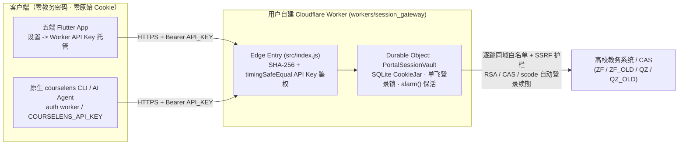

# 独立有状态 Cloudflare Worker 会话托管网关（API Key 认证）指南

除了项目根目录下面向纯前端跨域转发的**无状态中继**（[`relay/cloudflare_worker.js`](../relay/cloudflare_worker.js)），仓库在 [`workers/session_gateway/`](../workers/session_gateway/) 下提供了一个**完全独立的有状态 Cloudflare Worker 会话托管网关（`courselens-session-gateway`）**。

通过将其部署到你自己的 Cloudflare 账号（兼容 Cloudflare Workers Free Plan），教务系统的账号密码与登录会话 Cookie 将完全由你私有的 **Durable Object（SQLite 存储）** 在云端维护并定时自动续期；**五端 Flutter App** 与 **原生 `courselens` CLI / AI Agent** 只需凭借高熵 `API Key` 即可查询课表、成绩、考试、培养方案、空教室及执行受控选退课，实现**客户端设备零教务密码、零原始 Cookie 落盘**。

---

## 1. 为什么独立于无状态 Web Relay？

| 维度 | 无状态 Web 中继（`relay/cloudflare_worker.js`） | 有状态会话托管网关（`workers/session_gateway/`） |
| --- | --- | --- |
| **设计定位** | 协助纯浏览器前端跨越 CORS 与多跳 `302 Set-Cookie` 限制 | 个人私有云端教务会话保险箱，供多设备 App 与 CLI / AI Agent 共享在线态 |
| **云端存储状态** | **完全无状态**（零 Durable Object / KV / D1） | **有状态**（Durable Object `PortalSessionVault` 持久化 Cookie Jar 与元数据） |
| **教务凭据位置** | 客户端本地内存或平台安全存储 | 仅存于你自己的 Cloudflare Worker Secrets（客户端只存 `API Key`） |
| **自动续期能力** | 由活跃客户端触发重登 | Durable Object `alarm()` 周期探活 + 遇到 HTTP `901`/`401`/`403`/登录页重定向时单飞锁（Single-Flight）自动重登 1 次 |
| **配置文件** | 仓库根目录 [`wrangler.jsonc`](../wrangler.jsonc) | 独立配置 [`workers/session_gateway/wrangler.jsonc`](../workers/session_gateway/wrangler.jsonc) |

---

## 2. 架构与数据流



核心安全保障（严格遵循 [`docs/security.md`](security.md) 7 条硬红线）：
1. **常量时间 API Key 校验**：边缘入口将请求头 `Authorization: Bearer <key>`（或 `X-CourseLens-Key`）与 `COURSELENS_API_KEY`（支持逗号分隔多把 Key 以便平滑轮换）统一做 `SHA-256` 摘要后执行 `crypto.subtle.timingSafeEqual`，彻底防御时序侧信道。
2. **Cookie 双向隔离**：客户端发往 `/v1/proxy` 的 `Cookie` 头与上游响应的 `Set-Cookie` 头均被严格剥离，原始教务 `JSESSIONID` 永不离开 Durable Object。
3. **严格同校主机白名单与 SSRF 阻断**：Worker 仅允许访问由 `PORTAL_URL` 与可选 `PORTAL_CAS_URL` 推导出的同可注册高校域名（精确识别 `.edu.cn` / `.ac.cn` 双标签后缀），并阻断环回、私网（RFC1918）、链路本地（`169.254.0.0/16` 元数据地址）与 IPv6 ULA。
4. **写操作超时禁重发（红线 #3）**：对正方选退课写接口或会话过期触发自动重登时，客户端 `WorkerSessionHttpEngine` 在 `POST` 超时后抛出 `RESULT_UNKNOWN` 交由只读已选名单核验，绝不盲目重复提交写请求。

---

## 3. 部署与配置步骤

### 3.1 本地开发与单元测试

```bash
# 安装 Wrangler 依赖（首次）
npm ci

# 运行有状态 Worker 离线全链路单元测试（Node >= 22）
npm run session-worker:test

# 复制本地开发环境变量模板并填入测试配置（已加入 .gitignore）
cp workers/session_gateway/.dev.vars.example workers/session_gateway/.dev.vars

# 启动本地有状态 Worker 开发实例（默认 http://127.0.0.1:8788）
npm run session-worker:dev
```

### 3.2 部署到你自己的 Cloudflare Workers

1. 登录 Wrangler 并写入加密 Secrets（密钥仅保存在你的 Cloudflare 账号加密存储中，绝不写入代码库）：

```bash
# 1) 生成一把高强度随机 API Key（妥善保存，稍后填入 App 或 CLI）
openssl rand -hex 32

# 2) 配置 API Key（支持逗号分隔多把 Key，例如分别给手机 App 与桌面 CLI）
npx wrangler secret put COURSELENS_API_KEY --config workers/session_gateway/wrangler.jsonc

# 3) 配置高校教务系统根地址（例如青科大：https://jwglxt.qust.edu.cn/jwglxt）
npx wrangler secret put PORTAL_URL --config workers/session_gateway/wrangler.jsonc

# 4) 方式 A：账号密码自动登录与续期（支持新正方 jwglxt RSA、CAS 统一认证、强智 scode）
npx wrangler secret put PORTAL_USERNAME --config workers/session_gateway/wrangler.jsonc
npx wrangler secret put PORTAL_PASSWORD --config workers/session_gateway/wrangler.jsonc

# （可选）若学校走独立 CAS 统一身份认证门户，额外配置 CAS 登录地址：
# npx wrangler secret put PORTAL_CAS_URL --config workers/session_gateway/wrangler.jsonc

# （可选）若学校强制扫码/动态码无法无人值守账密登录，可注入初始 Cookie 种子（由 alarm 保活）：
# npx wrangler secret put PORTAL_COOKIES --config workers/session_gateway/wrangler.jsonc
```

2. 一键发布 Worker（自动完成 Free Plan 兼容的 SQLite Durable Object 迁移 `new_sqlite_classes: ["PortalSessionVault"]`）：

```bash
npm run session-worker:deploy
```

发布成功后，终端会输出你的专属 HTTPS 网关地址，例如：
`https://courselens-session-gateway.<your-subdomain>.workers.dev`

可随时探活验证（`/health` 不暴露任何账号或学校信息）：

```bash
curl -s https://courselens-session-gateway.<your-subdomain>.workers.dev/health
# {"ok":true,"service":"courselens-session-gateway","mode":"stateful-session","version":1}
```

### 3.3 环境变量与 Secrets 参考

| 变量名 | 必填 | 说明 |
| --- | :---: | --- |
| `COURSELENS_API_KEY`（或 `API_KEY`） | ✅ | 客户端鉴权密钥；支持逗号分隔多把密钥（如 `key_app,key_cli`）以按设备独立吊销 |
| `PORTAL_URL` | ✅ | 高校教务系统根地址（如 `https://jwglxt.qust.edu.cn/jwglxt`，裸域名可自动探测升级 `/jwglxt`） |
| `PORTAL_USERNAME` | 二选一 | 学号 / 教务账号（配合 `PORTAL_PASSWORD` 实现首次按需登录与过期自动重登） |
| `PORTAL_PASSWORD` | 二选一 | 教务或 CAS 登录密码 |
| `PORTAL_COOKIES` | 二选一 | 初始 Cookie 种子（支持 `k=v; k2=v2` 或 JSON 字典 `{"JSESSIONID":"..."}`，适合纯扫码门户） |
| `PORTAL_CAS_URL` | 可选 | 学校 CAS 统一身份认证入口（如 `https://sso.example.edu.cn/cas/login`） |
| `PORTAL_SYSTEM` | 可选 | 教务类型提示：`AUTO`（默认自动探测）、`ZF`、`ZF_OLD`、`QZ`、`QZ_OLD` |
| `KEEPALIVE_MINUTES` | 可选 | Durable Object `alarm()` 自动探活间隔分钟数（默认 `20`，设为 `0` 关闭定时探活） |

---

## 4. 在五端 Flutter App 中使用

1. 打开 CourseLens App，进入底部/侧边栏 **「设置」** 页；
2. 在 **「学校教务登录」** 卡片中切换协议分段至 **「Worker API Key 托管」**；
3. 填入你的 **有状态 Worker 网关地址**（如 `https://courselens-session-gateway.<your-subdomain>.workers.dev`），可点击 **「测试 Worker 网关」** 验证连通性（若误填为无状态 Web Relay 会自动给出明确提示）；
4. 填入 **Worker API Key**，点击 **「通过 API Key 连接」**。

连接成功后：
- **原生端（Android / iOS / macOS / Windows）**：API Key 加密保存在系统级安全存储（Keychain / Keystore / DPAPI）的 `dev.courselens.worker_keys` 命名空间，下次冷启动或切换账号时自动无感恢复；`SharedPreferences` 仅记录公开网关 URL，绝不落盘 API Key。
- **Web 端**：甚至无需额外部署无状态 Web Relay——有状态 Worker 原生支持 CORS 预检与 `Bearer` 鉴权，API Key 仅驻留当前浏览器标签页内存。

---

## 5. 在原生 CLI 与 AI Agent 中使用

> [!CAUTION]
> 与 `--password` 相同，CLI **严禁在命令行参数中直接传入 `--api-key <secret>`**（会被立即以 `SECURITY_REFUSED` 拒绝，防止被 `ps aux` 或 `.zsh_history` 记录）。请使用交互隐藏输入、`--api-key-stdin`、`--api-key-env` 或环境变量。

### 方式 A：绑定到系统安全存储（推荐日常终端使用）

```bash
# 1. 终端交互式隐藏回显输入 API Key（macOS 自动存入 Keychain，Linux 存入 0600 session.json）
courselens auth worker --url https://courselens-session-gateway.<your-subdomain>.workers.dev

# 或通过管道安全注入 API Key：
printf '%s\n' "$MY_WORKER_KEY" | courselens auth worker \
  --url https://courselens-session-gateway.<your-subdomain>.workers.dev \
  --api-key-stdin

# 2. 直接执行任意查询或两步确认选退课
courselens whoami
courselens today
courselens grades --stats
courselens schedule --ics ~/Desktop/semester.ics
courselens select --course-id <id>          # 干跑预检（退出码 2，零写发包）
```

> 执行 `courselens auth logout` 时，CLI 仅清理本机保存的 Worker 绑定记录，**不会**清空云端共享 Worker 会话，避免误踢掉正在共享该 Worker 会话的手机/平板 App。如需在云端强制刷新或清空 Cookie，可调用 `POST /v1/session/refresh` 或 `DELETE /v1/session`。

### 方式 B：零落盘环境变量模式（推荐 AI Agent / 容器 / 自动化脚本）

无需执行 `auth worker`、也无需配置 `COURSELENS_BASE_URL`——直接注入 `COURSELENS_WORKER_URL` 与 `COURSELENS_API_KEY` 即可零磁盘落盘运行：

```bash
export COURSELENS_WORKER_URL="https://courselens-session-gateway.<your-subdomain>.workers.dev"
export COURSELENS_API_KEY="your-secret-api-key"

courselens today
courselens exams --json
```

---

## 6. HTTP 接口契约速查

除 `GET /health`（及 `HEAD /health`）与 `OPTIONS /*` 外，所有 `/v1/*` 端点均要求请求头携带 `Authorization: Bearer <API_KEY>`（或 `X-CourseLens-Key: <API_KEY>`）：

| 方法与路径 | 说明 |
| --- | --- |
| `GET /health` | 公开探活，返回 `{"ok":true,"service":"courselens-session-gateway","mode":"stateful-worker"}` |
| `GET /v1/session[?offline=1]` | 确保云端教务会话在线（必要时单飞自动登录），返回脱敏后的 `baseUrl`、`casBaseUrl`、`systemId`、`username`、`identity` 与更新时间（不含任何密码或原始 Cookie 值） |
| `POST /v1/session/refresh` | 强制重新执行一次教务登录或探活并更新 Durable Object 中的 CookieJar |
| `DELETE /v1/session` | 显式销毁云端 Durable Object 中缓存的教务 Cookie 会话并取消定时保活 |
| `POST /v1/proxy` | 由 `WorkerSessionHttpEngine` 调用的受控代理端点：自动附带云端 Cookie 访问白名单内的教务 URL，遇到会话过期（HTTP `901`/登录重定向）时单飞自动重登并透明重放一次，返回 Base64 响应体供客户端 `lib/core/` 解析 |
