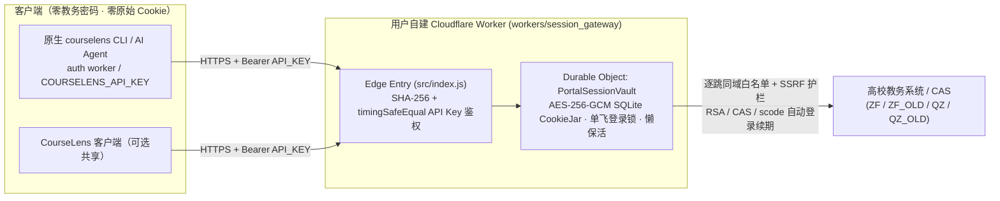

# 独立有状态 Cloudflare Worker 会话托管网关（API Key 认证）指南

仓库在 [`workers/session_gateway/`](../workers/session_gateway/) 下提供了一个**独立自托管的有状态 Cloudflare Worker 会话托管网关（`courselens-session-gateway`）**。

通过将其部署到你自己的 Cloudflare 账号（兼容 Cloudflare Workers Free Plan），教务系统的账号密码与登录会话 Cookie 将完全由你私有的 **Durable Object（SQLite 存储）** 在云端维护并按需自动续期；**原生 `courselens` CLI / AI Agent**（以及全平台 CourseLens App）只需凭借高熵 `API Key` 即可查询课表、成绩、考试、培养方案、空教室及执行受控选退课，实现**客户端设备零教务密码、零原始 Cookie 落盘**。

[](https://deploy.workers.cloudflare.com/?url=https://github.com/VanceHud/courselens-cli/tree/main/workers/session_gateway)

---

## 1. 无状态转发（`--relay`）与有状态会话网关（`--worker`）对比

| 维度 | 无状态 HTTP 转发网关（`--relay`） | 有状态会话托管网关（`workers/session_gateway/`） |
| --- | --- | --- |
| **设计定位** | 纯单次 HTTP 代理转发，不保存会话状态 | 个人私有云端教务会话保险箱，供 CLI / AI Agent 与多设备共享在线态 |
| **云端存储状态** | 完全无状态（零 Durable Object / KV / D1） | **有状态**（Durable Object `PortalSessionVault` 以 AES-256-GCM 静态加密持久化 `CookieJar`） |
| **教务凭据位置** | 客户端本地安全存储（Keychain / `0600` 文件） | 仅存于你自己的 Cloudflare Worker Encrypted Secrets（客户端只存 `API Key`） |
| **自动续期能力** | 由客户端重登 | 默认**懒保活**（平时零后台唤醒；请求遇 HTTP `901`/`401`/登录页重定向时单飞锁自动重登 1 次）+ 可选定时巡检 |
| **配置文件** | 外部自备 | 内置 [`workers/session_gateway/wrangler.jsonc`](../workers/session_gateway/wrangler.jsonc)（支持按钮一键部署与命令行发布） |

---

## 2. 架构与数据流



核心安全保障（严格遵循 [`docs/security.md`](security.md) 7 条硬红线）：
1. **常量时间 API Key 校验 + 占位密钥拒绝**：边缘入口将请求头 `Authorization: Bearer <key>`（或 `X-CourseLens-Key`）与 `COURSELENS_API_KEY`（支持逗号分隔多把 Key 以便平滑轮换）统一做 `SHA-256` 摘要后执行 `crypto.subtle.timingSafeEqual`，并拒绝示例占位密钥。
2. **Cookie 双向隔离与静态加密**：客户端发往 `/v1/proxy` 的 `Cookie` 头与上游响应的 `Set-Cookie` 头均被严格剥离；`CookieJar` 与 Webhook 签名密钥在 Durable Object SQLite 中以 HKDF 派生的 AES-256-GCM 密钥加密落盘。
3. **严格同校主机白名单与 SSRF 阻断**：Worker 仅允许访问由 `PORTAL_URL`、`PORTAL_CAS_URL` 与 `ALLOWED_HOSTS` 构成的高校域名白名单（精确识别 `.edu.cn` / `.ac.cn` 双标签公共后缀），并阻断环回、私网（RFC1918）、链路本地（`169.254.0.0/16` 元数据地址）与 IPv6 ULA。
4. **写操作超时禁重发（红线 #3）**：对正方选退课写接口，若上游 `POST` 超时则立即返回 HTTP `504 RESULT_UNKNOWN`，客户端自动转为只读已选名单核验，绝不盲目重复提交写请求。

---

## 3. 部署与配置步骤

### 3.1 方式一：点击按钮一键部署到 Cloudflare（推荐）

[](https://deploy.workers.cloudflare.com/?url=https://github.com/VanceHud/courselens-cli/tree/main/workers/session_gateway)

1. 点击上方按钮登录你的 Cloudflare 账号，Cloudflare 会将 `workers/session_gateway/` 作为独立仓库克隆到你的 GitHub/GitLab 账号下并引导填写以下 4 项 **Encrypted Secrets**（加密保存在 Cloudflare，**绝不会**提交进 Git 仓库）：
   - `COURSELENS_API_KEY`：高熵随机访问密钥（例如本机终端运行 `openssl rand -hex 32` 生成）
   - `PORTAL_URL`：学校教务系统根地址（如 `https://jwglxt.example.edu.cn/jwglxt`）
   - `PORTAL_USERNAME`：学号 / 教务账号
   - `PORTAL_PASSWORD`：教务或统一认证密码（若学校仅支持扫码/动态推送 Cookie、不托管密码，填 `COOKIE_ONLY`）
2. 若你的学校走独立域名的 CAS 统一身份认证（如 `https://sso.example.edu.cn/cas/login`），部署完成后可在 Cloudflare Dashboard → `courselens-session` → **Settings → Variables and Secrets** 添加 `PORTAL_CAS_URL`（`wrangler.jsonc` 已开启 `"keep_vars": true`，后续重部署不会覆盖 Dashboard 变量）。

### 3.2 方式二：使用 Wrangler 命令行手动部署

```bash
cd workers/session_gateway

# 1) 生成一把高强度随机 API Key（妥善保存，稍后填入 CLI）
openssl rand -hex 32

# 2) 注入加密 Secrets（仅保存在你的 Cloudflare 账号加密存储中，绝不写入代码库）
npx wrangler secret put COURSELENS_API_KEY
npx wrangler secret put PORTAL_URL
npx wrangler secret put PORTAL_USERNAME
npx wrangler secret put PORTAL_PASSWORD

# （可选）独立 CAS 门户地址或初始 Cookie 种子：
# npx wrangler secret put PORTAL_CAS_URL
# npx wrangler secret put PORTAL_COOKIES

# 3) 发布 Worker（自动完成 Free Plan 兼容的 SQLite Durable Object 迁移）
npx wrangler deploy
```

发布成功后会输出你的专属 HTTPS 网关地址（如 `https://courselens-session.<your-subdomain>.workers.dev`），可随时探活验证（`/health` 不暴露任何账号或学校信息）：

```bash
curl -s https://courselens-session.<your-subdomain>.workers.dev/health
# {"ok":true,"service":"courselens-session-gateway","mode":"stateful-worker","version":"1.1.0"}
```

### 3.3 本地开发与离线单元测试

```bash
cd workers/session_gateway
npm install

# 运行离线全链路单元测试（Node >= 22，零外部网络请求）
npm test

# 复制本地开发环境变量模板（已被 .gitignore 忽略）并启动本地开发实例
cp .dev.vars.example .dev.vars
npm run dev
```

### 3.4 环境变量与 Secrets 参考

| 变量名 | 必填 | 说明 |
| --- | :---: | --- |
| `COURSELENS_API_KEY`（或 `API_KEY`） | ✅ | 客户端鉴权密钥；支持逗号分隔多把密钥（如 `key_laptop,key_agent`）以按设备独立轮换吊销 |
| `PORTAL_URL` | ✅ | 高校教务系统根地址（如 `https://jwglxt.example.edu.cn/jwglxt`，裸域名可自动探测升级 `/jwglxt`） |
| `PORTAL_USERNAME` | 二选一 | 学号 / 教务账号（配合 `PORTAL_PASSWORD` 实现首次按需登录与过期自动重登） |
| `PORTAL_PASSWORD` | 二选一 | 教务或 CAS 登录密码；一键部署时若仅用扫码动态推送 Cookie 可填 `COOKIE_ONLY` |
| `PORTAL_COOKIES` | 二选一 | 初始 Cookie 种子（支持 `k=v; k2=v2` 或 JSON 字典 `{"JSESSIONID":"..."}`；也可部署后用 `courselens worker push-cookies` 动态推送） |
| `PORTAL_CAS_URL` | 可选 | 学校独立域名 CAS 统一身份认证入口（如 `https://sso.example.edu.cn/cas/login`） |
| `PORTAL_SYSTEM` | 可选 | 教务类型提示：`auto`（默认自动探测）、`ZF`、`ZF_OLD`、`QZ`、`QZ_OLD` |
| `ALLOWED_HOSTS` | 可选 | 额外允许转发的教务主机白名单（逗号分隔；`PORTAL_URL` 与 `PORTAL_CAS_URL` 所在源已自动放行） |
| `KEEPALIVE_INTERVAL_SEC` | 可选 | 后台定时心跳秒数（默认 `0` = **按需懒保活**，空闲零唤醒；仅纯种子 Cookie 需定时续期时设为如 `900`） |
| `SESSION_VERIFY_TTL_SEC` | 可选 | `GET /v1/session` 在线探活结果复用秒数（默认 `120`，减少重复探测上游） |
| `CORS_ORIGIN` | 可选 | 允许跨域访问的浏览器来源（默认 `*`） |

---

## 4. 在原生 CLI 与 AI Agent 中使用

> [!CAUTION]
> 与 `--password` 相同，CLI **严禁在命令行参数中直接传入 `--api-key <secret>`**（会被立即以 `SECURITY_REFUSED` 拒绝，防止被 `ps aux` 或 `.zsh_history` 记录）。请使用交互隐藏输入、`--api-key-stdin`、`--api-key-env` 或环境变量。

### 方式 A：绑定到系统安全存储（推荐日常终端使用）

```bash
# 1. 终端交互式隐藏回显输入 API Key（macOS 自动存入 Keychain，Linux 存入 0600 session.json）
courselens auth worker --url https://courselens-session.<your-subdomain>.workers.dev --name main

# 或通过管道安全注入 API Key：
printf '%s\n' "$MY_WORKER_KEY" | courselens auth worker \
  --url https://courselens-session.<your-subdomain>.workers.dev \
  --api-key-stdin

# 2. 直接执行任意查询、云端监控管理或两步确认选退课
courselens whoami
courselens today
courselens grades --stats
courselens worker monitor status
courselens select --course-id <id>          # 干跑预检（退出码 2，零写发包）
```

> 执行 `courselens auth logout` 时，CLI 仅清理本机保存的会话记录（加 `--keep-workers` 可保留多网关配置），**不会**清空云端共享 Worker 会话。后续网关代码有新版本时，可运行 `courselens update --worker` 自动通过 `wrangler deploy` 升级代码且不触碰已存 Secrets。

### 方式 B：零落盘环境变量模式（推荐 AI Agent / 容器 / 自动化脚本）

无需执行 `auth worker`、也无需配置 `COURSELENS_BASE_URL`——直接注入 `COURSELENS_WORKER_URL` 与 `COURSELENS_API_KEY` 即可零磁盘落盘运行：

```bash
export COURSELENS_WORKER_URL="https://courselens-session.<your-subdomain>.workers.dev"
export COURSELENS_API_KEY="your-secret-api-key"

courselens today
courselens exams --json
```

---

## 5. HTTP 接口契约速查

除 `GET /health`（及 `HEAD /health`）与 `OPTIONS /*` 外，所有 `/v1/*` 端点均要求请求头携带 `Authorization: Bearer <API_KEY>`（或 `X-CourseLens-Key: <API_KEY>`）：

| 方法与路径 | 说明 |
| --- | --- |
| `GET /health` | 公开探活，返回 `{"ok":true,"service":"courselens-session-gateway","mode":"stateful-worker","version":"1.1.0"}` |
| `GET /v1/session[?offline=1]` | 确保云端教务会话在线（必要时单飞自动登录），返回脱敏后的 `baseUrl`、`systemId`、`username`、`studentInfo` 与更新时间（不含任何密码或原始 Cookie 值） |
| `POST /v1/session/refresh` | 强制重新执行一次教务登录或探活并更新 Durable Object 中的 `CookieJar` |
| `POST /v1/session/cookies` | 动态推送扫码 / SSO 登录后的 Cookie 至云端 Durable Object 并在线核验存活 |
| `DELETE /v1/session` | 显式销毁云端 Durable Object 中缓存的教务 Cookie 会话并取消后台保活 |
| `POST /v1/proxy` | 由 `WorkerSessionHttpEngine` 调用的受控代理端点：自动附带云端 Cookie 访问白名单内的教务 URL，遇到会话过期时单飞自动重登并透明重放一次，返回 Base64 响应体供客户端 `lib/core/` 解析 |
| `GET \| PATCH \| DELETE /v1/tasks[/:taskId]`<br>`POST /v1/tasks/:taskId/run` | 统一云端任务中心：查看、独立启停或立即运行 `monitor:grades`、`monitor:exams`、`session:keepalive`（默认全部关闭） |
| `GET \| PATCH /v1/monitor`<br>`POST /v1/monitor/check` | 查看或修改成绩/考试变动定时巡检配置、重置指纹基线，或手动触发一次巡检 |
| `GET \| PUT \| DELETE /v1/webhook`<br>`POST /v1/webhook/test` | 配置或测试 Bark / 飞书 / 钉钉 / 企业微信 / Telegram / 通用 HMAC-SHA256 Webhook 通知（URL 自动脱敏回显、密钥加密落盘） |
